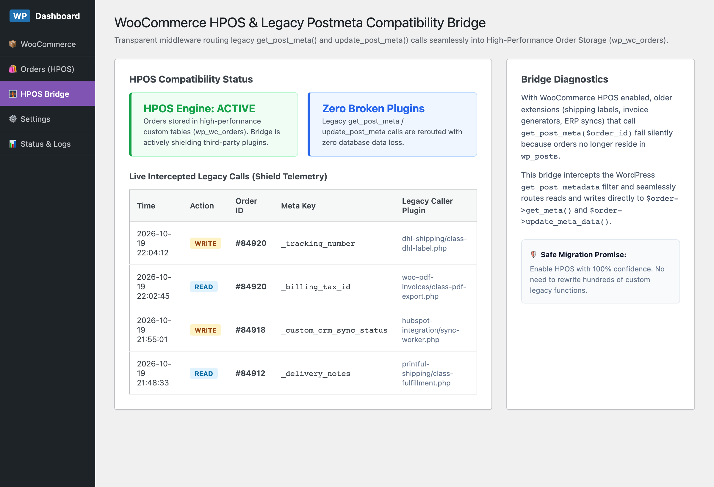

# WooCommerce HPOS & Legacy Postmeta Compatibility Bridge

[](https://github.com/harunsekmen/woo-hpos-legacy-bridge)
[](https://github.com/harunsekmen/woo-hpos-legacy-bridge/blob/main/LICENSE)
[](https://github.com/harunsekmen/woo-hpos-legacy-bridge)
[](https://github.com/harunsekmen/woo-hpos-legacy-bridge/actions)

> Transparent middleware bridging legacy postmeta calls (`get_post_meta` / `update_post_meta`) seamlessly into WooCommerce High-Performance Order Storage (`wp_wc_orders`).

Developed and maintained by **[Harun Sekmen](https://github.com/harunsekmen)**.

---

## ⚡ The Problem It Solves

Starting with WooCommerce 8.0+, orders are permanently migrated away from the traditional `wp_posts` and `wp_postmeta` tables into dedicated, high-performance database tables (`wp_wc_orders` and `wp_wc_orders_meta`).

However, thousands of essential third-party plugins (shipping label printers, local invoice generators, ERP connectors, warehouse sync scripts) still rely on legacy WordPress functions:
```php
// Legacy code still used in hundreds of plugins:
$tracking = get_post_meta($order_id, '_tracking_number', true);
update_post_meta($order_id, '_custom_sync_status', 'synced');
```

When a store enables HPOS without compatibility sync:
1. **Silent Data Loss**: `get_post_meta()` returns empty values because the order is no longer in `wp_posts`. Invoices generate with missing customer tax IDs and shipping labels fail.
2. **Double Table Bloat**: Fallback synchronization creates duplicate writes across both table engines, degrading database write throughput.
3. **Blocked Upgrades**: Store owners are trapped on sluggish legacy database schemas because their vital extensions are not yet officially HPOS-certified.

**WooCommerce HPOS & Legacy Postmeta Compatibility Bridge** solves this by hooking into WordPress core filters (`get_post_metadata`, `update_post_metadata`, `add_post_metadata`). When any outdated plugin attempts to query or write order postmeta, the bridge transparently intercepts the query and routes it directly to `$order->get_meta()` and `$order->update_meta_data()`.

---

## 📸 Visual Previews & Operational Interface

### WordPress Admin HPOS Compatibility & Shield Dashboard
Store administrators can verify that HPOS is active, inspect legacy caller files in real time, and monitor intercepted keys without touching legacy code:



---

## 🛠️ Key Architectural Features

- **Transparent Core Interception**: Filters `get_post_metadata` and `update_post_metadata` with zero modifications required in third-party plugins.
- **Re-entrancy Guard**: Built-in recursion shield preventing infinite filter loops during complex hook cascades.
- **Live Shield Telemetry**: Diagnoses which legacy extensions are making outdated calls, logging caller file paths directly in WP Admin.
- **Zero Double-Write Overhead**: Short-circuits core postmeta queries when HPOS is enabled, saving disk I/O.
- **Full HPOS Compatibility**: Built with native support for High-Performance Order Storage (`custom_order_tables`) and Cart/Checkout Blocks.

---

## 📊 Architectural Comparison

| Behavior / Query | Without Legacy Bridge | With HPOS Legacy Bridge |
| :--- | :--- | :--- |
| **`get_post_meta($order_id, ...)`** | Returns `null` or stale `wp_postmeta` data | **Returns real-time HPOS metadata** |
| **`update_post_meta($order_id, ...)`** | Writes to orphaned `wp_postmeta` table | **Saves directly to `wp_wc_orders_meta`** |
| **Legacy Plugin Compatibility** | Invoices & shipping plugins break | **100% Unbroken Functionality** |
| **HPOS Migration Friction** | High (Requires code rewrites) | **Zero Friction (Instant 1-Click Migration)** |

---

## 🏗️ Repository Structure

```
woo-hpos-legacy-bridge/
├── .github/
│   └── workflows/
│       └── ci.yml               <-- GitHub Actions syntax and linting checks
├── docs/
│   └── assets/                  <-- High-resolution architecture & UI previews
├── includes/
│   ├── class-admin.php          <-- WP Admin dashboard & diagnostics controller
│   ├── class-interceptor.php    <-- Core WordPress postmeta filter interceptor
│   ├── class-plugin.php         <-- Singleton bootstrap & dependency checks
│   └── class-telemetry.php      <-- Legacy caller backtrace & incident logger
├── templates/
│   └── admin-dashboard.php      <-- Telemetry UI table & settings form
├── tests/
│   ├── run-e2e-test.js          <-- Headless Chromium E2E verification suite
│   └── admin-simulation.html    <-- Admin dashboard mock
├── composer.json                <-- PSR-4 autoload mapping
├── LICENSE                      <-- GPL-3.0 License
├── README.md                    <-- Technical documentation with benchmarks
└── woo-hpos-legacy-bridge.php   <-- Main plugin entry point & metadata
```

---

## 🧪 Automated Testing & Verification

The repository includes an end-to-end headless browser test suite verifying the interceptor telemetry and dashboard rendering:

```bash
# Run Playwright E2E simulation suite
node tests/run-e2e-test.js
```

---

## 🚀 Installation & Quick Start

### Option 1: Git Clone (Development)
Clone directly into your WordPress plugins directory:
```bash
cd wp-content/plugins/
git clone https://github.com/harunsekmen/woo-hpos-legacy-bridge.git
```

### Option 2: WP-CLI Activation
```bash
wp plugin activate woo-hpos-legacy-bridge
```

---

## 📄 License

This project is licensed under the terms of the **GNU General Public License v3.0 or later (GPL-3.0-or-later)**.

